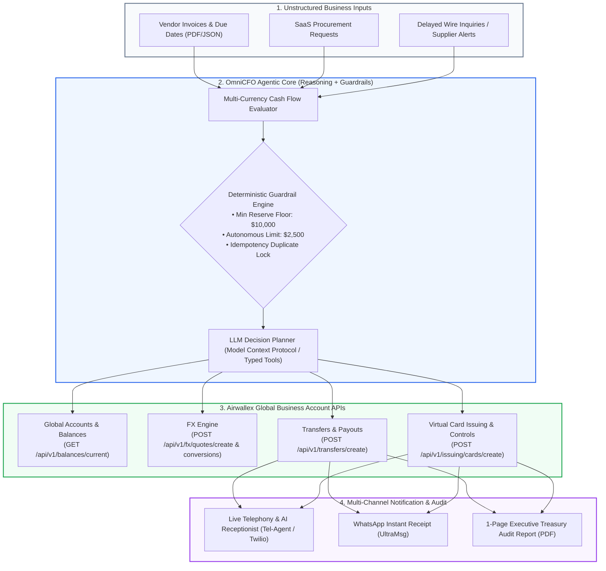

# 🏦 OmniCFO — Autonomous Agentic Banking & Treasury Platform

> **Built for the Airwallex Developer Lab Hackathon**  
> *Autonomous Multi-Currency Treasury Management, Intent-Bound Virtual Card Governance, and Payment Operations Incident Command powered by Airwallex Sandbox APIs & Agentic AI.*

---

## 🌟 Executive Summary

**OmniCFO** is an autonomous corporate financial operations agent engineered on the **Airwallex Developer Platform**. Modern cross-border companies operate across multiple global currencies (USD, EUR, GBP, AUD, SGD, INR), yet their treasury operations are trapped in fragmented, manual spreadsheets. Founders and finance leads constantly juggle:
1. **Unpredictable Foreign Exchange (FX) Volatility & Cash Crunches**: Having money in the wrong currency when high-priority international vendor deadlines hit.
2. **Rogue Recurring SaaS Subscriptions**: Overspending on corporate cards due to static limits and a lack of intent-binding.
3. **Stalled International Wire Transfers**: Suppliers reporting missed deadlines while finance teams are paralyzed by the fear of double-paying.

**OmniCFO** solves these challenges by combining **deterministic financial guardrails** (reserve floors, idempotency locks, MCC allowlists) with **agentic LLM reasoning (MCP Tools + Airwallex APIs)** to make real-time financial decisions, book dynamic FX conversions, issue policy-constrained virtual cards, and resolve payment incidents in seconds.

---

## 🎯 3 Core Airwallex Starter Kits Unified in One Platform

OmniCFO harmonizes three foundational Airwallex Developer Lab briefs into a cohesive, production-grade application:

```
┌────────────────────────────────────────────────────────────────────────────────────────────────────────┐
│                                       OMNICFO CORE PILLARS                                             │
├──────────────────────────────┬──────────────────────────────────┬──────────────────────────────────────┤
│ 1. ADAPTIVE TREASURY         │ 2. INTENT-BOUND VIRTUAL CARDS    │ 3. PAYMENT OPS INCIDENT COMMANDER    │
│    CONTROLLER (Kit 01)       │    (Kit 02)                      │    (Kit 03)                          │
├──────────────────────────────┼──────────────────────────────────┼──────────────────────────────────────┤
│ • Evaluates multi-currency   │ • Issues on-demand virtual cards │ • Resolves delayed supplier wires    │
│   obligations against cash   │   bound to exact purchase intent │   without duplicate payments.        │
│ • Preserves a strict reserve │ • Enforces single-use budgets,   │ • Enforces idempotent transfer locks │
│   floor ($10,000 safety net) │   currency allowlists, and MCCs  │ • Traces intermediate states: SENT,  │
│ • Executes optimal FX quotes │ • Auto-freezes immediately on    │   FAILED, CANCELLED, and PAID        │
│   and conversions (USD→EUR)  │   unauthorized spend attempts    │ • Issues replacement wires cleanly   │
└──────────────────────────────┴──────────────────────────────────┴──────────────────────────────────────┘
```

---

## 🏗️ System Architecture



---

## 🔬 Architectural Deep Dive

### 1. Adaptive Treasury Controller (Starter Kit 01)
* **The Decision**: When multiple obligations in USD, EUR, and GBP fall due simultaneously and liquidity is constrained, the agent decides what to fund, convert, defer, or escalate to human approval.
* **Airwallex Endpoints Used**:
  * `GET /api/v1/balances/current` — Read real-time multi-currency wallets.
  * `GET /api/v1/fx/rates/current` — Ingest live interbank foreign exchange rates.
  * `POST /api/v1/fx/quotes/create` — Lock single-use execution quotes.
  * `POST /api/v1/fx/conversions/create` — Convert major currencies (USD $\rightarrow$ EUR).
  * `POST /api/v1/transfers/create` — Execute local and SWIFT wire payouts.
* **Deterministic Policy**:
  * Hard reserve floor: `$10,000` must remain untouched in primary operating currency.
  * Autonomous limit: Any conversion or transfer $\le \$2,500$ executes automatically; amounts $> \$2,500$ require Human-in-the-Loop (HITL) approval.

### 2. Intent-Bound Virtual Card Governance (Starter Kit 02)
* **The Decision**: An engineer requests an annual subscription for a cloud database ($2,400/yr vs $240/mo). Paying annually saves 18% but breaches runway reserves. The agent selects monthly, generates an intent-bound virtual card, and enforces policy via hardware card controls.
* **Airwallex Endpoints Used**:
  * `POST /api/v1/issuing/cardholders/create` — Provision KYC-approved employee profile.
  * `POST /api/v1/issuing/cards/create` — Create virtual card with strict controls:
    * `limit`: Max `$250/month`.
    * `allowed_currencies`: `["USD"]`.
    * `allowed_categories`: Specific Merchant Category Codes (e.g., Computer Software).
  * `POST /api/v1/issuing/cards/{id}/update` — Instantly freeze/unfreeze card upon policy breach.
  * `POST /api/v1/simulation/issuing/create` — Simulate card authorizations, captures, and declines.

### 3. Payment Ops Incident Commander (Starter Kit 03)
* **The Decision**: A critical supplier transfer is delayed. The supplier demands payment, but the original wire status is pending. Paying blindly risks a duplicate transfer; doing nothing risks operational halt.
* **Airwallex Endpoints Used**:
  * `GET /api/v1/transfers` — Query status and trace transfer state machine (`SENT`, `PAID`, `CANCELLED`).
  * `POST /api/v1/simulation/transfers/{id}/transition` — Simulate bank returns or recalls.
  * `POST /api/v1/transfers/create` — Issue replacement transfer under a strict **idempotency duplicate lock** with a unique `request_id`.

---

## 📂 Project Structure

```
Agentic_Banking/
├── README.md                      # Complete system documentation & hackathon guide
├── package.json                   # Root workspace scripts
├── .env.example                   # Environment configuration template
│
├── backend/                       # Python FastAPI Agentic Backend
│   ├── main.py                    # API entrypoint & simulation endpoints
│   ├── requirements.txt           # Python dependencies
│   ├── config.py                  # Airwallex credentials & environment variables
│   ├── services/
│   │   ├── airwallex_client.py    # Airwallex REST & Sandbox API client
│   │   ├── treasury_controller.py # Adaptive treasury & FX management
│   │   ├── card_governance.py     # Intent-bound virtual card issuing & controls
│   │   ├── incident_commander.py  # Payment ops incident & duplicate lock engine
│   │   ├── voice_notifier.py      # Twilio voice call & UltraMsg WhatsApp dispatch
│   │   ├── tel_agent_notifier.py  # Tel-Agent AI receptionist gateway & MCP tools
│   │   └── pdf_generator.py       # 1-page executive audit report generator
│   └── tests/                     # Automated test suites for treasury & cards
│
└── frontend/                      # React 18 + Vite + Tailwind CSS Dashboard
    ├── index.html                 # Web entrypoint
    ├── vite.config.js             # Vite configuration
    ├── tailwind.config.js         # Tailwind styling
    ├── package.json               # Frontend dependencies
    └── src/
        ├── App.jsx                # Main financial mission control dashboard
        ├── main.jsx               # React DOM initialization
        ├── index.css              # Global styling & layout
        └── components/
            ├── Header.jsx         # Navigation, sandbox status & wallet connection
            ├── BalanceCards.jsx   # Real-time multi-currency balances (USD, EUR, GBP)
            ├── FXConverter.jsx    # Live FX quote & conversion visualizer
            ├── CardManager.jsx    # Intent-bound virtual card issuing & spend monitor
            ├── DecisionTrace.jsx  # Streaming agent reasoning & action log
            ├── ScenarioPanel.jsx  # 1-click hackathon simulation trigger panel
            └── ApprovalModal.jsx  # Human-in-the-loop executive sign-off dialog
```

---

## 🚀 Getting Started & Setup

### 1. Prerequisites
* **Node.js**: v18+ or v20+
* **Python**: 3.10+
* **Airwallex Sandbox Account**: Sign up at [sandbox.airwallex.com](https://sandbox.airwallex.com).
  > **Tip**: If prompted for a business name, use `New Business Sandbox` or `Sandbox Business` for instant automated sandbox approval.

### 2. Environment Configuration
Copy `.env.example` to `.env` in both backend and frontend directories:

```env
# Airwallex Sandbox API Credentials
AIRWALLEX_CLIENT_ID=your_sandbox_client_id
AIRWALLEX_API_KEY=your_sandbox_api_key
AIRWALLEX_API_URL=https://api.sandbox.airwallex.com

# Multi-Channel Notifications (Optional for live calls & WhatsApp)
TWILIO_ACCOUNT_SID=your_twilio_sid
TWILIO_AUTH_TOKEN=your_twilio_auth_token
TWILIO_PHONE_NUMBER=your_twilio_phone_number
ULTRAMSG_INSTANCE_ID=your_ultramsg_instance
ULTRAMSG_TOKEN=your_ultramsg_token
```

### 3. Run Backend Server
```powershell
cd backend
python -m venv venv
.\venv\Scripts\activate
pip install -r requirements.txt
python main.py
```
*Backend runs on `http://127.0.0.1:8000`*

### 4. Run Frontend Dashboard
```powershell
cd frontend
npm install
npm run dev
```
*Dashboard opens at `http://localhost:3000` or `http://localhost:5173`*

---

## 🎬 Live Hackathon Demo Walkthrough (The 3-Minute Script)

1. **Baseline View (0:00 - 0:45)**:
   * Dashboard loads with live multi-currency balances: `$50,000 USD`, `€8,000 EUR`, `£5,000 GBP`.
   * The agent maintains a strict `$10,000` reserve floor.
2. **Crisis 1: Multi-Currency Liquidity Crunch (0:45 - 1:30)**:
   * Click **"Trigger German Supplier Crunch"** in the Scenario Panel.
   * A `€12,000` critical shipping invoice arrives due in 2 hours. Available EUR is only `€8,000`.
   * **Agent Action**: The agent evaluates cash reserves, calculates required shortfall, books a live Airwallex FX quote, converts `$4,500 USD` to `€4,150 EUR`, and releases the supplier transfer while preserving the `$10,000` reserve floor.
3. **Crisis 2: Intent-Bound SaaS Spend Rogue Charge (1:30 - 2:15)**:
   * Click **"Issue Card & Simulate Breach"**.
   * Agent generates a virtual card for an employee bound to `$300/mo` on software MCC.
   * Simulate an unauthorized `$1,200` swipe at a non-software merchant.
   * **Agent Action**: Airwallex card controls decline the transaction instantly; the agent auto-freezes the card and dispatches an alert.
4. **Crisis 3: Delayed Wire Recovery (2:15 - 3:00)**:
   * Click **"Simulate Stalled Wire"**.
   * Wire status shows failed due to intermediary bank return.
   * **Agent Action**: The agent verifies the failure reason, engages the duplicate payment lock, generates a new idempotency `request_id`, dispatches a clean replacement transfer, and issues an executive PDF audit receipt.

---

## 🏆 Hackathon Evaluation Checklist

- [x] **Financial Decision Focus**: Agent chooses differently based on cash reserves, deadlines, and merchant category codes.
- [x] **Deterministic Guardrails**: Hard reserve floors, spend limits, and idempotency locks enforced in code, not prompts.
- [x] **Live Airwallex APIs**: Integrates Global Accounts, FX quotes/conversions, Transfer payouts, and Issuing virtual cards.
- [x] **Multi-Channel Alerting**: Instant telephony voice calls, WhatsApp receipts, and 1-page PDF audit reports.
- [x] **Interactive Demo UI**: One-click scenario injection allowing judges to test every edge case live.
