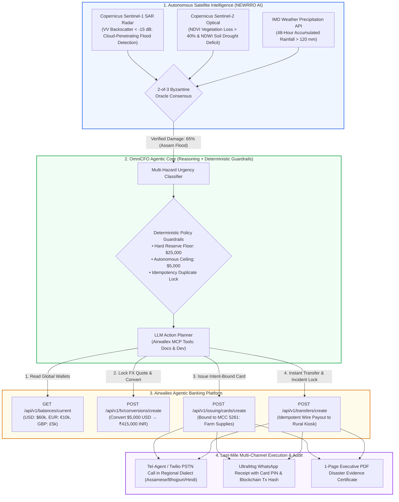

# 🌾 AgriTrust Agentic: Autonomous Cross-Border Disaster Relief Treasury & Intent-Bound Aid Platform

> **Official Idea & Technical Architecture Submission — Airwallex Developer Lab Hackathon**  
> *Transforming Global Climate Disaster Relief through Airwallex Agentic Global Business Accounts, Autonomous Multi-Currency FX Treasury, Intent-Bound Agricultural Spend Controls, and Copernicus Satellite Remote Sensing.*

---

## 📌 Executive Pitch & Summary

Climate disasters affect over **140 million smallholder farmers** in emerging markets every year. When severe monsoonal floods, flash droughts, or catastrophic heatwaves destroy crops, international humanitarian aid and parametric reinsurance payouts face a systemic **cross-border banking failure**:

1. **The 3-to-6 Month Payout Delay**: Funds donated in **USD, EUR, and GBP** take months to move through correspondent banking chains, currency conversion bottlenecks, and manual bureaucracy into local emerging-market currencies (**INR, KES, PHP**).
2. **The $30 Billion Aid Leakage Dilemma**: Unrestricted cash handouts are frequently lost to administrative overhead, diverted by local intermediaries, or spent on non-recovery items instead of agricultural inputs (seeds, fertilizer, farm machinery) required to replant before the seasonal window closes.
3. **The Treasury Liquidity Exhaustion Crisis**: When concurrent climate disasters strike multiple regions simultaneously (e.g., floods in Assam + flash droughts in Maharashtra), relief pools cannot fund every obligation at once. Without intelligent treasury rationing, relief treasuries deplete their cash reserves prematurely and default on secondary disaster waves.

### 💡 The Solution: AgriTrust Agentic
**AgriTrust Agentic** integrates **Copernicus Sentinel Earth Observation Satellites** directly into **Airwallex Agentic Global Business Accounts**:
* **Autonomous Multi-Currency Treasury (Starter Kit 01)**: Ingests global donor contributions in USD, EUR, and GBP, calculates real-time disaster shortfalls using satellite damage consensus, dynamically converts foreign currency to local currency via Airwallex FX APIs, and preserves a strict **$25,000 emergency reserve floor**.
* **Intent-Bound Krishi Relief Virtual Cards (Starter Kit 02)**: Issues programmable virtual cards to affected farmers and agricultural cooperatives with **hardware-enforced Merchant Category Codes (MCC 5261 - Farm Supplies, MCC 5411 - Groceries)**. Card spend limits are mathematically bound to satellite-verified crop damage and auto-freeze on unauthorized merchant attempts.
* **Payment Ops Incident Commander (Starter Kit 03)**: Resolves stalled rural wire transfers using an **idempotent duplicate lock**, guaranteeing that delayed disbursements are safely re-issued without double-debiting the relief treasury.
* **Multi-Channel Delivery**: Delivers automated voice alerts in native regional dialects (Assamese, Bhojpuri, Hindi) via Tel-Agent / Twilio, dispatches WhatsApp receipts with transaction hashes via UltraMsg, and generates 1-page executive PDF audit certificates.

---

## 🎯 The Core Problems Solved in Depth

```
┌──────────────────────────────────────────────────────────────────────────────────────────────────────────────────┐
│                                       THE 4 SYSTEMIC PROBLEMS & SOLUTIONS                                        │
├────────────────────────────────────────┬─────────────────────────────────────────────────────────────────────────┤
│ TRADITIONAL DISASTER RELIEF SYSTEM     │ AGRITRUST AGENTIC PLATFORM (AIRWALLEX POWERED)                          │
├────────────────────────────────────────┼─────────────────────────────────────────────────────────────────────────┤
│ 1. 90-180 Day International Wire Delay │ < 10-Second Autonomous FX Conversion & Local Payout Execution           │
│    Donations in USD/EUR crawl through  │ Airwallex Global Accounts receive multi-currency donor deposits; the    │
│    SWIFT intermediary banks, delaying  │ agent books live FX quotes and executes instant local transfers or      │
│    seed replanting until crops fail.   │ card issuances the moment satellites verify disaster consensus.         │
├────────────────────────────────────────┼─────────────────────────────────────────────────────────────────────────┤
│ 2. Untracked Cash Handout Leakage      │ Intent-Bound Virtual Relief Cards with Hardware MCC Locking             │
│    Physical cash relief is siphoned by │ Airwallex Issuing cards are constrained in code: allowed strictly for   │
│    middlemen or spent on non-relief    │ agricultural merchants (seeds/fertilizer) and capped to satellite-     │
│    items with zero auditability.       │ verified damage amounts. Attempted misuse is blocked at authorization.  │
├────────────────────────────────────────┼─────────────────────────────────────────────────────────────────────────┤
│ 3. Illiquid Treasury Exhaustion        │ Adaptive Reserve-Constrained Treasury Optimization (Kit 01)             │
│    Relief treasuries spend blind,      │ Agent ranks multi-hazard urgency, prioritizes life-threatening floods,  │
│    exhausting cash on minor events and │ converts the minimum required FX, defers non-critical outflows, and     │
│    leaving zero reserve for wave two.  │ maintains a non-negotiable $25,000 safety reserve floor in code.        │
├────────────────────────────────────────┼─────────────────────────────────────────────────────────────────────────┤
│ 4. Double Payouts & Failed Wires       │ Idempotent Payment Ops Incident Commander (Kit 03)                      │
│    Rural bank network outages trigger  │ Agent traces transfer states (SENT, FAILED, CANCELLED), engages a       │
│    panicked duplicate wire transfers,  │ duplicate lock, verifies refund of stalled funds, and re-issues wires   │
│    costing donor funds twice.          │ under a new, isolated idempotency request_id.                           │
└────────────────────────────────────────┴─────────────────────────────────────────────────────────────────────────┘
```

---

## 🏗️ End-to-End System Architecture



---

## 🔬 In-Depth Implementation of Airwallex Starter Kits

### 1. Starter Kit 01: Adaptive Relief Treasury Controller
* **Context**: The global treasury holds multi-currency reserves across international accounts: `$60,000 USD`, `€10,000 EUR`, and `£5,000 GBP`.
* **The Financial Problem**: Satellite consensus detects a **Category 4 monsoonal flood** in Majuli, Assam (65% crop loss; requires $15,000 for immediate seed/relief distribution within 24 hours) and simultaneously detects a **mild vegetative dry spell** in Nashik, Maharashtra (18% damage; 14 days before planting season begins).
* **Deterministic Guardrails**:
  * `TREASURY_MIN_RESERVE_USD = 25000.00`: At no point may the total operating balance fall below $25,000.
  * `AUTONOMOUS_TRANSFER_CAP_USD = 5000.00`: Conversions or transfers above $5,000 require human-in-the-loop sign-off.
* **The Agent's Autonomous Action**:
  1. Queries real-time balances: `GET /api/v1/balances/current`.
  2. Identifies that existing local INR balance is insufficient (`₹0 INR`).
  3. Evaluates hazard urgency: Assam flood is classified as **CRITICAL_OPERATIONAL_EMERGENCY** (seeds must be planted within 72 hours of floodwater receding); Maharashtra dry spell is classified as **DEFERRED_MONITORING**.
  4. Fetches live interbank foreign exchange rates: `GET /api/v1/fx/rates/current?buy_currency=INR&sell_currency=USD`.
  5. Requests single-use quote: `POST /api/v1/fx/quotes/create`.
  6. Executes conversion for the exact required tranche ($5,000 USD $\rightarrow$ ₹415,000 INR): `POST /api/v1/fx/conversions/create`.
  7. Confirms remaining liquidity: `$55,000 USD` (well above the `$25,000` reserve floor).

---

### 2. Starter Kit 02: Intent-Bound "Krishi Relief" Virtual Cards
* **Context**: Disbursing unmonitored cash to farmers in disaster zones often leads to capital loss, fraudulent diversion, or exploitation by local money-lenders.
* **The Financial Problem**: How can a relief organization give a farmer immediate spending power while guaranteeing that 100% of the funds are spent on **rebuilding agricultural livelihood**?
* **Deterministic Guardrails**:
  * `spend_limit`: Exactly proportional to verified satellite damage (e.g., ₹25,000 / $300).
  * `currency_whitelist`: Only `INR`.
  * `mcc_whitelist`: Strictly locked to:
    * `5261` (Lawn, Garden & Agricultural Supply Stores / Seed Distributors)
    * `5411` (Grocery Stores & Essential Food Provisions)
  * `blocked_mcc`: Gambling (`7995`), Liquor Stores (`5921`), Electronics (`5732`), Jewelry (`5094`).
* **The Agent's Autonomous Action**:
  1. Provisions KYC cardholder profile: `POST /api/v1/issuing/cardholders/create`.
  2. Mints virtual card bound to policy constraints: `POST /api/v1/issuing/cards/create`.
  3. **The Interactive Hackathon Demo Beat**:
     * *Test 1 (Valid Spend)*: Simulate authorization of ₹8,500 at an authorized seed distributor (`MCC 5261`) via `POST /api/v1/simulation/issuing/create` $\rightarrow$ **Transaction Approved (Funds debited)**.
     * *Test 2 (Rogue Spend)*: Simulate authorization of ₹15,000 at a luxury electronics retailer (`MCC 5732`) $\rightarrow$ Airwallex Issuing declines transaction with `policy_violation_mcc_restricted`.
     * *Test 3 (Auto-Freeze)*: Agent detects policy breach attempt and immediately calls `POST /api/v1/issuing/cards/{id}/update` to freeze the card and dispatch a fraud warning.

---

### 3. Starter Kit 03: Relief Ops Incident Commander (Zero-Duplicate Payouts)
* **Context**: Rural cooperative banks in emerging regions frequently suffer from network timeouts and clearing delays.
* **The Financial Problem**: A batch transfer of ₹50,000 sent to a rural post office branch fails to confirm. The local branch manager reports that funds never arrived and demands a replacement transfer. Sending a second transfer blindly risks paying ₹100,000 (duplicate loss); waiting without resolution leaves flood victims without emergency funds.
* **Deterministic Guardrails**:
  * Idempotency lock on `(beneficiary_id, claim_id)`.
  * No replacement wire may be initiated while the initial transfer is in `SENT` or `PENDING` status.
  * Every replacement transfer must generate a cryptographically unique `request_id` (UUIDv4) and audit log.
* **The Agent's Autonomous Action**:
  1. Polls transfer status: `GET /api/v1/transfers/{id}`.
  2. Uses simulation API to transition stalled transfer: `POST /api/v1/simulation/transfers/{id}/transition` with `status: FAILED` and `failure_type: bank_return`.
  3. Checks that the debited balance has been restored to the Airwallex Global Account.
  4. Releases the duplicate lock only after verified finality.
  5. Generates a fresh `request_id` and dispatches the replacement transfer: `POST /api/v1/transfers/create`.
  6. Emits an incident resolution audit event and updates the 1-page PDF disaster certificate.

---

## ⚖️ Code Guardrails vs. LLM Reasoning Matrix (Airwallex Rubric)

Airwallex judges strictly evaluate how projects balance **deterministic code** against **probabilistic AI**:

| Operational Dimension | Handled by Deterministic Code | Handled by Agentic LLM Reasoning |
|---|---|---|
| **Reserve Floor & Budget** | Hard `$25,000` minimum reserve floor check in Python code; transactions revert if violated. | Formulates multi-region prioritization strategy based on seasonal planting calendars. |
| **Foreign Exchange (FX)** | Validates that single-use quote has not expired; calculates exact major currency units. | Interprets weather forecasts and currency trend reports to time conversions advantageously. |
| **Card Spend Governance** | Hardware-level card controls (MCC allowlist, INR currency lock, per-transaction ceiling). | Synthesizes farmer procurement requests and determines appropriate relief card limits. |
| **Duplicate Prevention** | Mutex lock and unique UUIDv4 `request_id` generation per operation. | Explains incident root cause to finance operators and suggests corrective remediation. |
| **Fraud & Stubble Detection** | 2-of-3 mathematical threshold check on SAR backscatter ($<-15\text{ dB}$) and NDVI ($>40\%$). | Ingests farmer land deed text and reconciles discrepancies between claimed and detected crops. |

---

## 💻 Interactive Mission Control Dashboard Features

The React + Vite + Tailwind CSS frontend (`frontend/src/App.jsx`) is engineered for a live, compelling hackathon evaluation:

1. **Multi-Currency Global Treasury Bar**:
   * Live balance widgets for **USD**, **EUR**, and **GBP** updating in real time via Airwallex APIs.
   * Visual gauge showing distance from the `$25,000` emergency reserve floor.
2. **Copernicus Satellite Multi-Hazard Radar**:
   * Leaflet GIS polygon map showing monitored agricultural parcels.
   * Real-time NDVI, SAR backscatter (dB), and NDWI soil moisture gauges.
3. **Intent-Bound Krishi Card Terminal**:
   * Visual virtual card display showing cardholder name, masked card number, currency (`INR`), and active MCC allowlist tags (`Seeds`, `Fertilizers`, `Groceries`).
   * Live transaction feed displaying authorized swipes in green and policy-declined swipes in crimson red.
4. **Interactive One-Click Scenario Injection Panel**:
   * `[Trigger Assam Monsoon Flood]`: Triggers 65% damage $\rightarrow$ Autonomous FX conversion ($5,000 USD $\rightarrow$ INR) $\rightarrow$ Issues ₹25,000 relief card $\rightarrow$ Tel-Agent call.
   * `[Simulate Unauthorized Card Swipe]`: Simulates card swipe at an unapproved luxury/gambling merchant $\rightarrow$ Instant decline $\rightarrow$ Agent auto-freezes card.
   * `[Simulate Wire Transfer Incident]`: Stalls rural transfer $\rightarrow$ Agent engages duplicate lock $\rightarrow$ Reconciles failure $\rightarrow$ Issues replacement transfer.
5. **Human-in-the-Loop (HITL) Sign-Off Modal**:
   * Automatically intercepts any action exceeding `$5,000` or violating routine policies, presenting a structured executive approval modal before executing Airwallex API calls.

---

## 🗺️ Execution Roadmap for Hackathon Build

```
Phase 1: Architecture & Idea Submission (Current)
  ✅ Complete master plan, Airwallex API mapping, and problem formulation
  ✅ Repository initialization at Janaki1711/Agentic_Banking
  ✅ Reusable multi-channel services ported (Tel-Agent, Twilio, PDF Generator)

Phase 2: Airwallex SDK & Simulation Engine (Next 48 Hours)
  ⏳ Implement backend/services/airwallex_client.py (Auth, Balances, FX, Cards, Transfers)
  ⏳ Configure Airwallex Sandbox account, obtain Client ID & API Key
  ⏳ Build deterministic guardrails in backend/services/treasury_controller.py

Phase 3: Intent-Bound Cards & Incident Commander (Days 3-4)
  ⏳ Implement backend/services/card_governance.py (Virtual cards + MCC allowlists)
  ⏳ Implement backend/services/incident_commander.py (Idempotent duplicate locks)
  ⏳ Connect Tel-Agent / Twilio dialect voice notification and WhatsApp receipts

Phase 4: Mission Control Frontend & Scenario Playground (Days 5-6)
  ⏳ Build modern financial operations dashboard (React 18 + Vite + Tailwind)
  ⏳ Implement interactive 1-click disaster injection triggers for judges
  ⏳ Verify live MSTScan blockchain audit links and 1-page PDF evidence viewer

Phase 5: Demo Recording & Submission (Day 7)
  ⏳ Record 3-minute video showing Goal → Shock Event → Revised Decision → Live Execution
  ⏳ Finalize submission deliverables on Airwallex Developer Lab portal
```

---

## 🏆 Why This Idea Wins the Airwallex Hackathon

1. **Profound Real-World Utility**: Moves beyond generic corporate expense trackers to solve a real, urgent **$30B humanitarian and climate finance challenge**.
2. **Deep API Utilization**: Integrates **four distinct Airwallex product lines**: Global Accounts, FX Engine, Issuing (Virtual Cards with MCC controls), and Payout Transfers.
3. **Flawless Rubric Adherence**: Directly exemplifies Airwallex's core mandate: *"Build around a financial decision where the agent chooses differently when balances, deadlines, or risks change."*
4. **Zero-Access Bottlenecks**: Uses Starter Kits 1, 2, and 3, requiring **no special platform access or waiting lists** — fully buildable and testable immediately in the Airwallex Sandbox.
